# Bản đồ kiến trúc (hình)

**Mô tả:** Sơ đồ **vẽ bằng ký tự** — hiển thị trực tiếp trong Cursor/GitHub, không cần plugin Mermaid.

← [Trang chủ Map](README.md) · [Hướng dẫn đọc](huong-dan-doc/README.md)

---

## 0. Sơ đồ bấm được (khuyên dùng)

1. **[Mở index.html — sơ đồ bấm được](../../index.html)** (gốc repo VietPOS-Map; 10 hub + runtime + chỉ mục).
2. **Mermaid hub** (preview Markdown — bấm nút trên sơ đồ nếu viewer hỗ trợ `click`):

```mermaid
flowchart TB
  HOME[Trang chủ Map]
  HOME --> H0["Kiến trúc hệ thống"]
  HOME --> H1["Đăng nhập và phiên làm việc"]
  HOME --> H2["POS và đơn hàng"]
  HOME --> H3["Sản phẩm và tồn kho"]
  HOME --> H4["Hóa đơn đầu vào (VAT mua vào)"]
  HOME --> H5["Hóa đơn bán ra (Viettel)"]
  HOME --> H6["Chuỗi và nhiều cửa hàng"]
  HOME --> H7["An ninh và chặn truy cập"]
  HOME --> H8["Offline và đồng bộ"]
  HOME --> H9["Trợ lý AI, widget, đếm khách"]
  click HOME "../README.md" "Mục lục"
  click H0 "../chuyen-de/kien-truc-he-thong/README.md" "Kiến trúc hệ thống"
  click H1 "../chuyen-de/dang-nhap-va-phien/README.md" "Đăng nhập và phiên làm việc"
  click H2 "../chuyen-de/pos-va-don-hang/README.md" "POS và đơn hàng"
  click H3 "../chuyen-de/san-pham-va-kho/README.md" "Sản phẩm và tồn kho"
  click H4 "../chuyen-de/hoa-don-dau-vao/README.md" "Hóa đơn đầu vào (VAT mua vào)"
  click H5 "../chuyen-de/hoa-don-ban-ra/README.md" "Hóa đơn bán ra (Viettel)"
  click H6 "../chuyen-de/chuoi-cua-hang/README.md" "Chuỗi và nhiều cửa hàng"
  click H7 "../chuyen-de/an-ninh-truy-cap/README.md" "An ninh và chặn truy cập"
  click H8 "../chuyen-de/offline-dong-bo/README.md" "Offline và đồng bộ"
  click H9 "../chuyen-de/tro-ly-widget/README.md" "Trợ lý AI, widget, đếm khách"
```



| Hub | Mô tả ngắn |
|-----|------------|
| [Kiến trúc hệ thống](../chuyen-de/kien-truc-he-thong/) | Sơ đồ tổng thể: pos-app, api-server, Postgres, offline, cloud-sync — đọc đầu tiên. |
| [Đăng nhập và phiên làm việc](../chuyen-de/dang-nhap-va-phien/) | JWT, shop đang chọn, hub shop, quyền menu. |
| [POS và đơn hàng](../chuyen-de/pos-va-don-hang/) | Quầy bán, giỏ hàng, thanh toán, ca làm việc, hủy đơn. |
| [Sản phẩm và tồn kho](../chuyen-de/san-pham-va-kho/) | Danh mục SP, tồn shop, phiếu nhập/xuất, PO. |
| [Hóa đơn đầu vào (VAT mua vào)](../chuyen-de/hoa-don-dau-vao/) | Import PDF/Excel, kéo CQT, MST lọc, ghép hàng, nhập kho. |
| [Hóa đơn bán ra (Viettel)](../chuyen-de/hoa-don-ban-ra/) | Phát hành HĐ VAT từ POS, tra cứu, form công khai. |
| [Chuỗi và nhiều cửa hàng](../chuyen-de/chuoi-cua-hang/) | Tổ chức, shop, kho, điều chuyển, dashboard chuỗi. |
| [An ninh và chặn truy cập](../chuyen-de/an-ninh-truy-cap/) | Chặn IP/thiết bị, quan sát truy cập, super_admin. |
| [Offline và đồng bộ](../chuyen-de/offline-dong-bo/) | IndexedDB, checkout offline, API sync. |
| [Trợ lý AI, widget, đếm khách](../chuyen-de/tro-ly-widget/) | Agent chat, widget Android, ESP32 visitor-counts. |

---

## 1. Hệ thống VietPOS (runtime)

```
┌─────────────────────────────────────────────────────────────────┐
│                     MÁY NGƯỜI DÙNG                            │
│  ┌──────────────┐      ┌──────────────────┐                     │
│  │ Trình duyệt  │      │ IndexedDB        │                     │
│  │ hoặc Tauri   │─────▶│ (offline: đơn,   │                     │
│  │              │      │  HĐ chờ sync)    │                     │
│  └──────┬───────┘      └────────▲─────────┘                     │
│         │                       │ pull / push                   │
│         │  HTTPS  /api/*        │                               │
│         ▼                       │                               │
└─────────┼───────────────────────┼───────────────────────────────┘
          │                       │
          ▼                       │
┌─────────────────────────────────┴───────────────────────────────┐
│                      api-server (Express)                        │
│   JWT · quyền shop · Viettel/CQT · nghiệp vụ POS/kho/HĐ VAT      │
└─────────┬───────────────────────────────┬───────────────────────┘
          │ Drizzle                         │ cloud-sync (tùy chọn)
          ▼                                 ▼
┌──────────────────┐              ┌──────────────────┐
│ PostgreSQL       │              │ Postgres cloud   │
│ (máy chủ shop)   │─────────────▶│ (Railway, ops)   │
└──────────────────┘   mirror     └──────────────────┘

     Widget Android / ESP32 ──API key──▶ visitor-counts, widget/home
```

| Thành phần | Ghi chú |
|------------|---------|
| **pos-app** | React — POS, kho, HĐ, cấu hình chuỗi |
| **api-server** | Một cửa `/api` cho mọi nghiệp vụ |
| **local-db + sync** | Quầy vẫn bán khi mất mạng |
| **cloud-sync** | Sao chép DB lên cloud (không thay thế DB local) |

*Phiên bản Mermaid (nếu IDE hỗ trợ):* [chuyen-de/kien-truc-he-thong/README.md](chuyen-de/kien-truc-he-thong/README.md)

---

## 2. Bản đồ tài liệu VietPOS-Map (cách đi)

```
                    ┌─────────────────────────────┐
                    │  ban-do-kien-truc/README.md (đây)  │
                    │  sơ đồ hình + hướng dẫn     │
                    └──────────────┬──────────────┘
                                   │
         ┌─────────────────────────┼─────────────────────────┐
         ▼                         ▼                         ▼
┌─────────────────┐    ┌──────────────────────┐    ┌─────────────────┐
│ 00-huong-dan    │    │ 00-muc-luc (trang    │    │ chuyen-de/      │
│ (3 bước đọc)    │    │ chủ Map)             │    │ 10 hub chủ đề   │
└────────┬────────┘    └──────────┬───────────┘    └────────┬────────┘
         │                        │                         │
         │            chọn 1 chủ đề (POS, HĐ đầu vào…)     │
         │                        └────────────┬────────────┘
         │                                     ▼
         │              ┌──────────────────────────────────────────┐
         │              │  Trên mỗi hub, đọc theo thứ tự:           │
         │              │  ① nghiep-vu/  →  ② frontend-pages/      │
         │              │  →  ③ api-modules/  →  ④ schema/        │
         │              │  →  ⑤ lib-modules/ (một phần)             │
         │              └────────────────────┬─────────────────────┘
         │                                   │
         │         cần tra hết URL / file    ▼
         │              ┌──────────────────────────────────────────┐
         └─────────────▶│  chi-muc/  (danh sách dài, tách riêng)   │
                        │  · api-modules · trang-giao-dien          │
                        │  · thu-vien-backend · schema · endpoint   │
                        └──────────────────────────────────────────┘

   reference/  = doc gốc Shop (tiếng Anh) — RBAC, database, Docker
```

---

## 3. Hub chủ đề (chọn một nhánh)

```
                    [00-muc-luc / chuyen-de]
                              │
    ┌────────────┬────────────┼────────────┬────────────┐
    ▼            ▼            ▼            ▼            ▼
 Đăng nhập     POS &       Sản phẩm    HĐ đầu vào   HĐ bán ra
 & phiên       đơn hàng    & kho       (VAT mua)    (Viettel)
    │            │            │            │            │
    └────────────┴────────────┴────────────┴────────────┘
                              │
         Chuỗi shop · An ninh · Offline · Trợ lý/widget
```

Danh sách link đầy đủ (bấm được): mục **[0. Sơ đồ bấm được](#0-sơ-đồ-bấm-được-khuyên-dùng)** phía trên · [Trang chủ Map](README.md)

---

## 4. Luồng dữ liệu HĐ đầu vào (tóm tắt)

```
 PDF / Excel / CQT sync
         │
         ▼
  vat_inbound_invoices (Postgres)
         │
         ├── MST lọc? ──▶ archived → tab "Khác"
         │
         ▼
  Ghép dòng SP (stock-receipt) → nhập kho (receive-stock) → tồn + giá vốn
```

Chi tiết: [hoa-don-dau-vao](../chuyen-de/hoa-don-dau-vao/README.md)
