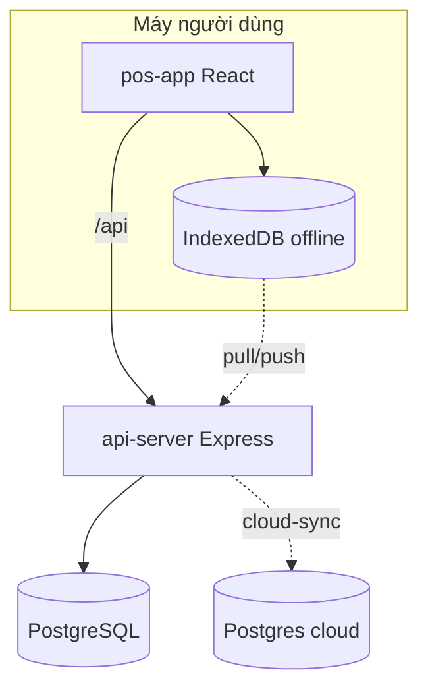

# Kiến trúc hệ thống

**Mô tả:** Sơ đồ tổng thể: pos-app, api-server, Postgres, offline, cloud-sync — đọc đầu tiên.

**Về trang chủ Map:** [README.md](../../README.md) · [Hướng dẫn đọc](../../huong-dan-doc/)

Hệ thống VietPOS gồm **giao diện web** (pos-app), **API** (api-server) và **PostgreSQL**.
Máy quầy có thể ghi **offline** (IndexedDB) rồi đồng bộ; tùy chọn **cloud-sync** lên Postgres cloud.

| Thành phần | Vai trò |
|------------|---------|
| **pos-app** | Màn hình POS, kho, HĐ VAT, cấu hình chuỗi |
| **api-server** | Xử lý nghiệp vụ, quyền JWT, gọi Viettel/CQT |
| **@workspace/db** | Schema Drizzle → Postgres |
| **local-db / sync** | Đơn & HĐ chờ đẩy khi mất mạng |
| **cloud-sync** | Mirror DB lên Railway (ops) |

**Bản đồ hình (ASCII, luôn hiển thị):** [ban-do-kien-truc/README.md](../ban-do-kien-truc/README.md)

**Chi tiết từng phần:** [he-thong/01](../he-thong/01-kien-truc-runtime/README.md) · [02 workspace](../he-thong/02-workspace-luu-niem/README.md) · [03 monorepo](../he-thong/03-monorepo-packages/README.md) · [04 Docker](../he-thong/04-docker-va-cloud-sync/README.md)

---

*Sinh tự động — `python3 docs/gen.py`*
